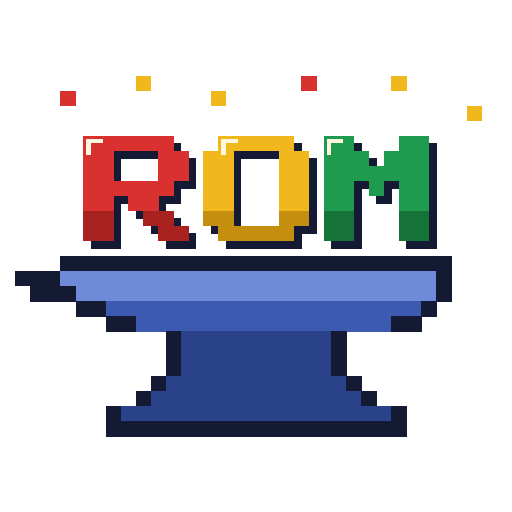

  

<h1 align="center">romforge</h1>

  <strong>Your retro game collection, identified, tidied and ready to play.</strong> 
  A Linux desktop app (and command-line tool) for ROM collections: it finds
  out exactly what each file is, gives it the right name and art, and starts
  it in the right emulator, from the desk or the sofa with a game pad.

  
  
  

---

## What it does

| | |
|---|---|
| 🔍 **Identifies every game** | Checks each file against No-Intro, Redump, TOSEC, MAME and ScummVM lists by its fingerprint, not its name, even inside zips, 7z and CHDs. Only an exact match counts as verified. |
| 🗂️ **Tidies your collection** | Renames and repacks games into one clean folder (zip for cartridges, CHD for discs), with every step previewed first and one-click undo. |
| 🖼️ **Fills in the details** | Box art, screenshots, fanart, logos, descriptions, developers, series and release dates from free open sources. Optional keys add more. |
| 🕹️ **Plays them** | Starts each game in RetroArch or the right standalone emulator (DuckStation, PCSX2, Dolphin, PPSSPP, ScummVM, MAME and more), with its saves and BIOS kept in one place. |
| 📺 **Feels like a console** | A fullscreen mode for the TV, driven by a game pad, with themes and hotkeys that work the same in every emulator. |
| 🌐 **Translations and hacks** | Patches a game you own into a translated or hacked copy, never touching the original. |

**Your files are safe.** Scanning only reads. Nothing is moved, renamed
or repacked until you've seen the plan and said yes, and every change can
be undone.

## Install

Download from the [latest release](https://github.com/asafelobotomy/romforge/releases/latest):

| Your system | Download |
|---|---|
| Debian, Ubuntu, Mint | `romforge_<version>_amd64.deb` |
| Fedora, openSUSE | `romforge-<version>-1.x86_64.rpm` |
| Arch, Manjaro | the `PKGBUILD` (`romforge-bin`): `makepkg -si` |
| Anything else | `romforge_<version>_amd64.AppImage` (portable, needs FUSE) |

Install **RetroArch** (with a few cores) and any standalone emulators you
like; romforge finds them on its own, Flatpaks too.

## Getting started

1. **Open romforge.** On first run it offers to make a `RomForge` folder:
   one portable place for your library, games, art, saves and BIOS files.
2. **Get the game lists.** In **DATs**, download the lists for your
   systems (one click per system, or all of them).
3. **Scan a folder** of ROMs. Each game shows as *verified*, a *candidate*,
   or *unknown*, and nothing is changed.
4. **Search** helps name what wasn't recognised; **Enrich** fetches art
   and details for the games you pick.
5. **Rename & Cleanup** shows its plan, then moves your verified games
   into the RomForge folder, neatly named. Undo puts everything back.
6. **Play.** Pick a game and press **Play**, or press **Fullscreen** (F11)
   and pick up a pad.

## Playing with a game pad

The fullscreen mode lays your platforms along the top and their games
below as large box art. **A** opens a game, **A** again plays it,
**X** makes it a favourite, **Start** opens the menu (with **Search**, an
on-screen keyboard for the pad, and **Music**). **Favourites**, **Recently
played** and **Most played** sit beside All games. While a game runs,
romforge goes to the tray and comes back when it ends.

In Settings → Display you can also turn on an **attract mode** (your games
shown in turn when the pad is left alone, then a screensaver), choose a
folder of your own **music** to play in the fullscreen mode (paused while
you play), and on a game's page pick the **emulator** that game uses.

These hotkeys work in every supported emulator:

| Hold | Press | Does |
|---|---|---|
| Select | Start | Quit the game |
| Select | R1 / L1 | Save / load a state |
| Select | R2 / L2 (held) | Fast forward / rewind |
| L3 | R3 | The emulator's menu |
| L3 for 2 seconds | right stick | A ring of all of these, over the game |

Quit works everywhere. RetroArch, DuckStation and PCSX2 get the full set.

## On a Steam Deck

**Settings → Steam → Add to Steam…** puts romforge in your Steam library
(close Steam first): it opens in the fullscreen mode, with its own art,
and starts your games itself. A **romforge (Deck)** controller template
comes with it; pick it once in romforge's controller settings in Steam.
It maps the back buttons: L4 quits a game, R4 held opens the ring of
hotkeys.

## Themes

Pick the fullscreen look from **Start → Theme** or **Settings → Display**:
**SNES UK** (the default, light or dark), **Famicom**, **Mega Drive** or
**Game Boy**, each with a grid or list layout, a text size and its own
options. **Get themes…** downloads more made by the community, from
[romforge-themes](https://github.com/asafelobotomy/romforge-themes), each
with its licence shown first. You can make your own from a colour file and
a stylesheet; see the [guide](GUIDE.md#fullscreen-themes).

## Where the data comes from

romforge uses free, open sources first: [libretro](https://github.com/libretro/libretro-database)
and its thumbnails, [Wikidata](https://www.wikidata.org), and the No-Intro,
Redump and TOSEC lists. Keys for ScreenScraper, SteamGridDB and IGDB are
optional extras, never required. ROMs, BIOS files and game lists are never
included or downloaded for you: bring your own.

## More

- **[The guide](GUIDE.md)**: the command-line tool, how identification
  works, every screen of the app, themes, and building from source.
- **[The plan](PLAN.md)**: what's built and what's next.

## Licence

romforge is [MIT](LICENSE). It uses icons from [game-icons.net](https://game-icons.net)
(CC BY 3.0) and [RetroArch's assets](https://github.com/libretro/retroarch-assets)
(CC BY 4.0); the [guide](GUIDE.md#licences-and-credits) has the full credits.
